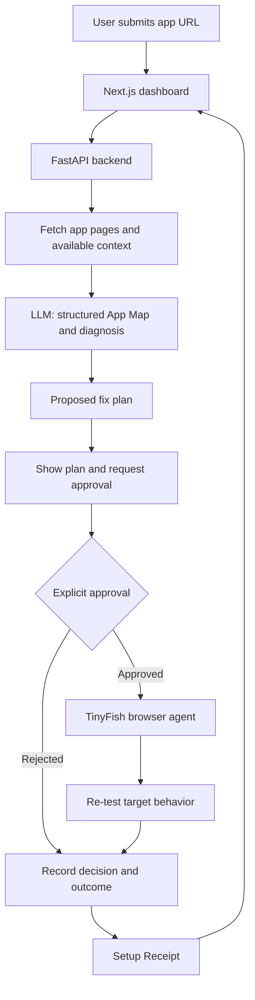

# VibePilot

> **AI built your app. VibePilot gets it ready to ship.**

VibePilot is an AI-assisted deployment and configuration agent for people building applications with tools such as Lovable, Bolt, v0, Replit, and Cursor. It aims to help builders understand their app, diagnose setup problems, apply approved changes in real provider dashboards, and verify the outcome with an evidence-backed Setup Receipt.

**Hackathon:** HackIIITD — 24–25 October 2026  
**Team:** Bit-01  
**Team members:** Akshita Goyal, Divya Maliwal, Harsh Gupta

> **Project status:** Hackathon prototype in development. Features described below are the intended design unless explicitly demonstrated in the running implementation. Do not assume provider automation or verification is live until it has been tested.

## The problem

AI coding tools can generate an application quickly, but builders still need to understand the generated app and configure services outside the codebase. Common examples include OAuth redirect URLs, environment variables, hosting settings, and webhook configuration.

This last-mile work is spread across code, documentation, and provider dashboards. A preview may work while the deployed application fails. A saved configuration setting alone also does not prove the integration works.

## The solution

VibePilot brings the setup workflow into one place:

1. **Understand** — inspect an app URL and, where available, its source or metadata to build a plain-English App Map.
2. **Diagnose** — use a browser agent to inspect a real failure and collect the visible error and relevant URL.
3. **Plan** — turn the observed evidence into a structured, actionable fix plan.
4. **Approve** — show the user the proposed state-changing action and wait for explicit approval.
5. **Act** — perform the approved action in a supported provider dashboard, or guide the user through it if automation is unavailable.
6. **Verify** — re-run the relevant check and record what actually happened.
7. **Receipt** — show the changes, test outcomes, timestamps, evidence, and remaining manual steps.

### Example scenario

A builder's **Sign in with Google** flow fails on the deployed domain with `redirect_uri_mismatch`.

VibePilot's intended workflow is to observe the error, identify the redirect URI involved, propose adding the URI to the correct OAuth client, wait for the user's approval, perform or guide the change, and retry the login. The receipt should distinguish a successful test from a failed or untested one.

## Why VibePilot?

- **Understands, not just advises:** explains app structure and connects findings to evidence.
- **Acts with permission:** sensitive configuration changes require explicit user approval.
- **Verifies outcomes:** a saved setting is not treated as proof that the app works.
- **Keeps a trace:** stores step results and evidence for a readable Setup Receipt.
- **Has a guided fallback:** if an automation step fails or requires human authentication, the workflow can hand control back to the user.

## Intended users

- **Non-technical founders** launching apps made with AI coding tools.
- **Students and indie hackers** who need to configure and test deployments quickly.
- **Small development agencies** that want repeatable setup checks and client-facing evidence.

## MVP scope

The first target is one complete, demonstrable setup workflow—not support for every provider.

**Primary demo flow:** app URL → App Map → diagnose a real issue → propose a fix → approval → provider action or guided fallback → re-test → Setup Receipt.

The build plan prioritizes a deliberately misconfigured Google OAuth demo app. If the Google Cloud console flow proves unreliable, a simpler supported setup such as a Supabase redirect URL or Vercel environment-variable workflow can be considered.

### Planned screens

1. **App Map** — pages, features, services, observed data flows, and setup gaps.
2. **Live Setup Run** — execution trace, current state, evidence, and approval prompt.
3. **Setup Receipt** — actions, outcomes, screenshots when available, timestamps, and outstanding work.

### Out of scope for the initial MVP

- Full multi-provider automation.
- DNS management and multiple payment-provider integrations.
- Billing, team accounts, and a production-grade multi-tenant platform.
- Claims of complete security auditing or guaranteed production readiness.

These are possible future directions, not promises of the current prototype.

## Architecture



### Planned run states

`ANALYZING` → `DIAGNOSING` → `AWAITING_APPROVAL` → `EXECUTING` → `VERIFYING` → `DONE`

A run may instead end in `FAILED` or `GUIDED` when automation cannot safely or reliably continue.

### Planned API contract

| Endpoint | Purpose |
|---|---|
| `POST /analyze` | Start an analysis and return a run/job identifier. |
| `GET /jobs/{id}/stream` | Stream run progress and agent trace using Server-Sent Events (SSE). |
| `POST /jobs/{id}/approve` | Record approval for the proposed action. |
| `GET /jobs/{id}/receipt` | Retrieve the run's evidence log and receipt. |

Endpoint details and response schemas may change during implementation.

## Technology stack

| Component | Planned technology | Purpose |
|---|---|---|
| Frontend | Next.js, React, TypeScript, Tailwind CSS | Dashboard and workflow screens |
| Backend | Python, FastAPI | API, orchestration, approval and run state |
| AI | LLM with structured JSON output | App Map, diagnosis, and fix plan |
| Browser automation | TinyFish APIs | Read pages and operate supported provider dashboards |
| Persistence | SQLite for the compact prototype; PostgreSQL as a future option | Run history and evidence |
| Progress streaming | Server-Sent Events (SSE) | Live run trace |
| Testing | HTTP checks and browser-based tests where applicable | Validate observed behavior |

The architecture may evolve. A Redis queue, provider-specific recipes, parallel jobs, and a dedicated secrets manager are roadmap items unless present in the implementation.

## Getting started

The exact commands depend on the current repository structure. The following is a suggested local setup for a repository with separate `frontend/` and `backend/` directories.

### Prerequisites

- Node.js and npm
- Python 3.11 or a compatible project-supported version
- Git
- API credentials for the LLM provider used by the implementation
- TinyFish API access for real browser-agent execution

Do not commit credentials to Git.

### 1. Clone the repository

```bash
git clone https://github.com/Akshita1140/vibePilot.git
cd vibePilot
```

### 2. Configure the backend

```bash
cd backend
python -m venv .venv
```

Activate the environment:

**macOS/Linux**
```bash
source .venv/bin/activate
```

**Windows PowerShell**
```powershell
.venv\Scripts\Activate.ps1
```

Install the dependencies declared by the project:

```bash
pip install -r requirements.txt
```

Create a local `.env` file using the environment-variable names expected by the backend. For example, these are illustrative names, not a guarantee that the current code uses them:

```dotenv
LLM_API_KEY=replace_with_your_key
TINYFISH_API_KEY=replace_with_your_key
DATABASE_URL=sqlite:///./vibepilot.db
```

Run the API using the project's actual FastAPI entry point. For example, if the module is `main.py` and exports `app`:

```bash
uvicorn main:app --reload
```

### 3. Configure the frontend

In a separate terminal:

```bash
cd frontend
npm install
```

Create the frontend environment file using the API URL variable expected by the code. For example:

```dotenv
NEXT_PUBLIC_API_URL=http://localhost:8000
```

Start the development server:

```bash
npm run dev
```

Open the local URL printed by Next.js, commonly `http://localhost:3000`.

> **Important:** Verify directory names, dependency files, entry-point names, and environment-variable names against the actual repository before following these commands. This README draft is based on the project plan and does not confirm that these files or scripts already exist.

## Human approval and safety

VibePilot is designed to keep the user in control of consequential actions.

- Require explicit approval before state-changing provider operations.
- Enforce approval in the backend, not only in the frontend.
- Restrict execution to supported, allowlisted actions and known targets.
- Do not send raw credentials or secret values to the LLM.
- Mask sensitive values in logs and receipts.
- Stop and request human intervention for CAPTCHA, 2FA, unexpected screens, or low-confidence actions.
- Record the action proposed, approval decision, observed result, and available evidence.
- Report failed, blocked, and untested checks honestly; never label them as passed.
- Use a dedicated test project/account for demonstrations wherever possible.

A receipt is evidence-backed only to the extent that its recorded checks and artifacts were actually collected. A generated report is not, by itself, proof of security or production readiness.

## Verification and definition of done

The intended MVP is ready for demonstration when the team can repeatedly show that:

- [ ] Submitting an app URL produces an App Map.
- [ ] The agent observes a real setup error or clearly reports that diagnosis could not be completed.
- [ ] A specific proposed fix is shown to the user.
- [ ] An unapproved state-changing action cannot execute.
- [ ] The approved change is performed, or guided mode clearly completes the manual handoff.
- [ ] A re-test records the real result.
- [ ] The Setup Receipt displays action history, evidence when available, and remaining work.
- [ ] Run success and failure counts are logged; the build plan targets at least 5 successful runs out of the last 6.

Do not mark a checkbox as complete until it has been tested against the running implementation.

## Team responsibilities

The project plan divides work by subsystem:

- **Frontend:** App Map, Live Setup Run, approval UI, Setup Receipt, and API integration.
- **Backend + AI:** FastAPI, source/context analysis, structured LLM output, run state, and persistence.
- **Automation + verification:** TinyFish integration, provider setup recipes, approval enforcement support, live checks, evidence capture, and receipt data.

Team members: Akshita Goyal, Divya Maliwal, and Harsh Gupta. Confirm the final ownership split with the team.

## Roadmap

- [ ] Complete the end-to-end Google OAuth setup workflow.
- [ ] Improve retries and guided-mode fallback.
- [ ] Make run history and evidence persistence reliable.
- [ ] Add a second provider recipe if the core workflow is stable.
- [ ] Explore additional providers such as Supabase, Vercel, Stripe, or Razorpay.
- [ ] Consider a CLI or developer-tool integration after the web MVP.

## Known limitations

- Browser automation can be slower and less reliable than direct provider APIs.
- Provider interfaces may change, and some operations may require human authentication.
- An app URL alone cannot reveal every internal route, database table, secret, or data flow.
- A successful HTTP response does not prove every user journey works.
- Findings and fix plans depend on the evidence available to the analyzer and model.
- Production readiness cannot be guaranteed by a single scan or test.

## Contributing

This is a hackathon prototype. For team contributions:

1. Agree on API schemas before integrating frontend and backend changes.
2. Keep credentials in local environment files and out of version control.
3. Commit small, testable changes frequently.
4. Record reproducible steps for bugs and integration failures.
5. Test the complete user journey before the final demo.

## License

No license has been specified yet. Add a `LICENSE` file before distributing the project for reuse.

---

**Pitch:** *AI writes the app. VibePilot understands it, fixes the setup in real dashboards—with your approval—and proves it works.*
